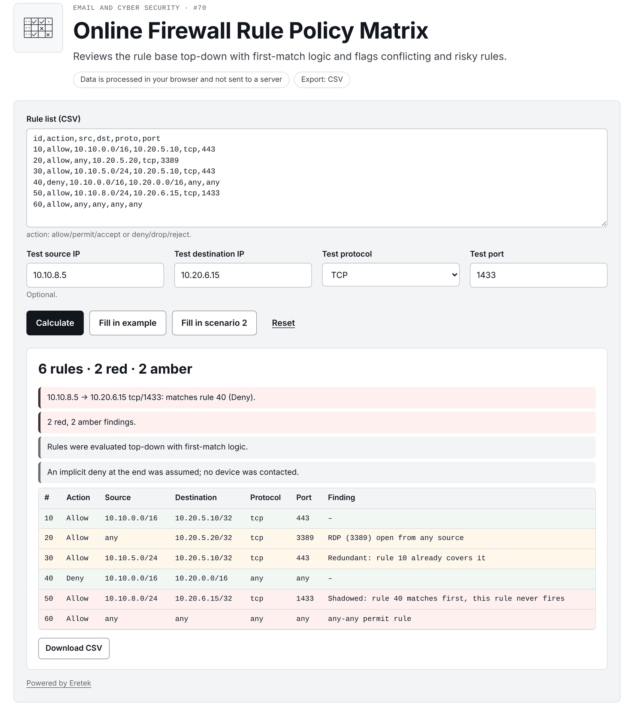

# Firewall Rule Policy Matrix

Find shadowed, redundant, any-any and risky-port rules in a firewall rule list (CSV); test which rule a sample packet hits using first-match logic.

## Try it live

- [Türkçe](https://siberguvenlik.eretek.com/araclar/firewall-kural-matrisi)
- [English](https://siberguvenlik.eretek.com/en/tools/firewall-rule-matrix)
- [Deutsch](https://siberguvenlik.eretek.com/de/werkzeuge/firewall-regelmatrix)



## What it does

Reviews the rule base top-down with first-match logic and flags conflicting and risky rules.

Rule bases that grow over years accumulate rules that never fire (shadowed) because a broader rule sits above them, duplicate rules and forgotten 'temporary' any-any permits. The tool compares rules by IPv4/IPv6 CIDR, protocol and port range and optionally shows which rule a test packet hits. It does not connect to devices or write anything.

## Where it helps

Remove shadowed rules or move them to the right position; make changes in a maintenance window with a backup. Use the device's own policy analyzer for NAT, application identification and user-based rules.

## How to use it

1. Paste the rules in order as CSV: `id, action, src, dst, proto, port`. Address: CIDR, IP or any; port: single, range (1000-2000) or any.
2. Optionally enter source, destination, protocol and port for a test packet.
3. Press Run; download findings as CSV.

### Fields

| Field | Description |
|---|---|
| Rule list (CSV) | action: allow/permit/accept or deny/drop/reject. |
| Test source IP | Optional. |
| Test destination IP |  |
| Test protocol |  |
| Test port |  |

## Example input

Press **Fill in example** in the tool to load this input.

| Input | Value |
|---|---|
| Test source IP | `10.10.8.5` |
| Test destination IP | `10.20.6.15` |
| Test protocol | `TCP` |
| Test port | `1433` |

**Rule list (CSV)**

```text
id,action,src,dst,proto,port
10,allow,10.10.0.0/16,10.20.5.10,tcp,443
20,allow,any,10.20.5.20,tcp,3389
30,allow,10.10.5.0/24,10.20.5.10,tcp,443
40,deny,10.10.0.0/16,10.20.0.0/16,any,any
50,allow,10.10.8.0/24,10.20.6.15,tcp,1433
60,allow,any,any,any,any
```

**Expected result:** Rule 20 exposes RDP to any source; 30 duplicates 10; 50 never fires because it is shadowed by the deny in 40; 60 is any-any. The test packet (10.10.8.5 → 10.20.6.15 tcp/1433) is denied by rule 40.

## Method and assumptions

A rule never matches if an earlier rule fully covers it in source, destination, protocol and port: same action means 'redundant', different action 'shadowed'. Partial overlaps are not reported.

Risky ports (22, 23, 161, 445, 1433, 3306, 3389, 5900) are flagged when the source is any. The test packet is evaluated against the first matching rule from the top.

## Limits and common mistakes

- Address/service object groups, zones/interfaces, NAT, schedules and application (L7) matching are not supported; expand objects into CIDRs and ports.

## Run it locally

The tool is plain HTML, CSS and JavaScript with no build step and no dependencies.

```bash
git clone https://github.com/eretek/firewall-rule-matrix.git
cd firewall-rule-matrix
node scripts/serve.js        # or: python3 -m http.server 8080
```

Open <http://127.0.0.1:8080/>. Add `?lang=tr` or `?lang=de` for Turkish or German; without it the page follows the browser language and falls back to English. You can also open `index.html` directly from disk.

Run the tests (Node.js 18 or later):

```bash
node test/run.js    # or: npm test
```

The tests run the tool's own fixtures and the worked examples in all three languages without a browser.

## How it works

All processing happens in your browser. The tool makes no network requests, uses no cookies or browser storage, and does not upload files you select.

No server-side component is needed. The version on the Eretek website renders the same page through a private WordPress plugin; that plugin only produces the page markup and is not part of this repository.

| Path | Purpose |
|---|---|
| `index.html` | Page shell |
| `src/app.js` | Builds the page in Turkish, English or German from `src/data.js` |
| `src/data.js` | Field definitions, examples and all texts in three languages |
| `src/core.js` | Shared runtime: validation, number formats, result rendering, CSV/ICS export |
| `src/tool.js` | The calculation or analysis for this tool |
| `docs/screenshot.png` | Screenshot used in this README |
| `src/lib/ip.js` | IPv4/IPv6 library (BigInt) |
| `src/tools.css`, `src/page.css` | Styles |
| `test/run.js`, `test/cases.json` | Headless tests |

## License and attribution

This tool is released under the [Eretek Website Attribution License](LICENSE). You may use, modify and redistribute it, including commercially. If you make it available on a website or web application, show a visible, clickable credit linking to https://eretek.com/ on every page where the tool is available, for example:

```html
<a href="https://eretek.com/">Powered by Eretek</a>
```

You may add `rel="nofollow"` to the link. Keep the copyright notice and license text in copies and redistributions.
